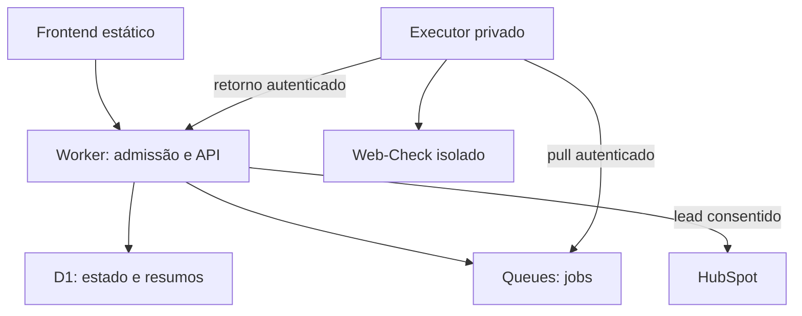
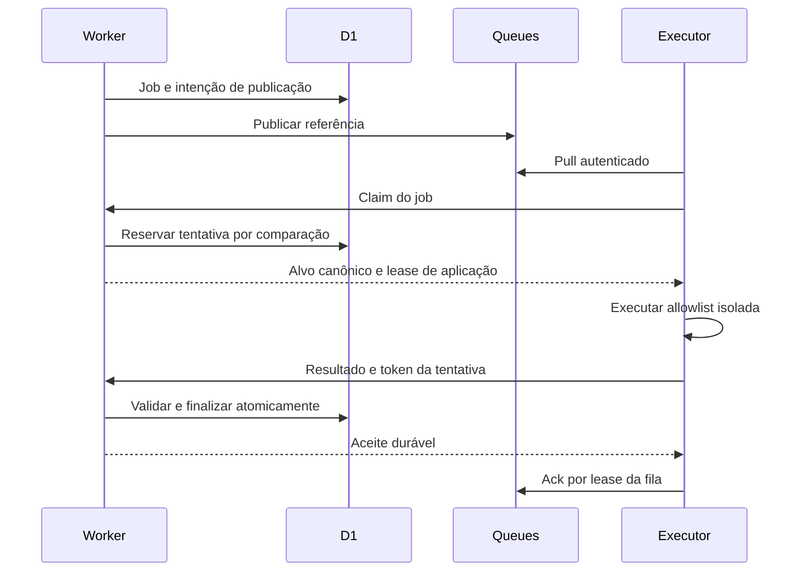

# Arquitetura e contratos

## 1. Componentes e limites

**Decidido:** Cloudflare-first, Web-Check sem fork e executor privado substituível. **Condicional:** Oracle Arm. **Proposto:** todo contrato, esquema, mecanismo de lease, recuperação e parâmetro abaixo, salvo indicação explícita. Evidência e status em [fontes](sources.md); comportamento de produto em [spec](spec.md).



| Componente | Responsabilidade | Limite |
|---|---|---|
| Frontend | Entrada, polling, relatório, consentimento | Nenhum segredo; não calcula resultado autoritativo |
| Worker | Validar entrada, Turnstile, quotas, disponibilidade, jobs, acesso, normalização final, scoring e leads | Não varrer alvo; não confiar no browser/executor |
| D1 | Estado indispensável, tentativas, evidências resumidas, leads e pendências | Sem HTML bruto, screenshots ou logs integrais de scan |
| Queues | Transporte assíncrono com redelivery | Não é fonte única de estado nem entrega exatamente uma vez |
| Supervisor do executor | Pull, claim, orçamento, isolamento, coleta, normalização estrutural e callback | Credenciais inacessíveis ao processo upstream; sem inbound público de scan |
| Web-Check | Executar somente allowlist local | Sem acesso a CRM, D1 ou credenciais; rede restrita |
| HubSpot | Receber pedido consentido e apoiar processo comercial | Falha não bloqueia diagnóstico; mapeamento ainda pendente |

Essas são responsabilidades lógicas. Gateway, adaptador final e scoring podem estar no mesmo Worker; supervisor e motor podem compartilhar a VM com isolamento entre processos/contêineres. Sem serviços adicionais por princípio.

## 2. Integração upstream

Consulta estática em 07/11/2026, commit `fd08be81f700254214ef49d093e71a991567841f`. É uma referência inspecionada, **não** o pin aprovado para produção. Caminhos e links imutáveis em [S3–S8](sources.md).

| Família proposta | Arquivo upstream existente | Adaptação/limite observado |
|---|---|---|
| HTTP/headers | `api/headers.js`, `api/http-security.js` | Headers e indicadores de presença; status 200 da API não significa coleta válida. Interpretar `error` e anti-bot; não reutilizar interpretação de headers como garantia |
| TLS | `api/ssl.js` | Obtém certificado e autorização TLS, permitindo handshake com certificado inválido para observá-lo; validar identidade, validade e `authError` em fixtures |
| DNS | `api/dns.js` | Consulta múltiplos tipos; erros podem virar arrays vazios. Não inferir ausência confirmada/segurança de array vazio sem comprovação |
| Tecnologias | `api/tech-stack.js` | Wappalyzer/Chromium: **proposto desabilitar no MVP** |

Allowlist candidata: `headers`, `http-security`, `ssl`, `dns`. Evitar coleta duplicada de headers quando o contrato permitir; conjunto final e observação de transporte HTTP/redirect precisam de teste de fidelidade e orçamento de rede. Não presumir que os quatro endpoints entregam toda evidência necessária ao scoring. Regras sem evidência suportada ficam inconclusivas e impedem nota conforme a spec. Nada de `/api/all`, descoberta automática de checks ou fallback para instância pública.

Configuração upstream oferece `API_ENABLED_CHECKS`/`API_DISABLED_CHECKS` e `DISABLE_GUI`. Usar allowlist explícita, desligar GUI, e validar que checks novos não entram após update. Não habilitar `ports`, `trace-route`, `screenshot`, `cookies`, `tech-stack`, `tls-labs`, Shodan ou outras integrações externas. A instalação conter Chromium não autoriza sua execução.

O helper HTTP segue redirects e lê corpo; o middleware usa corrida de timeout que não comprova cancelamento. Portanto limites externos de processo, egress e bytes são necessários; validar limite de redirects sem depender só da validação inicial. O Dockerfile inspecionado inclui Chromium/traceroute; segurança e compatibilidade não decorrem da imagem existir. O workflow prevê amd64/arm64, mas isso não comprova manifesto nem execução da imagem escolhida.

Sem fork: consumir artefato upstream pinado, configurar e proteger por supervisor/rede. Se não for possível aplicar as garantias da seção 5 externamente, **bloquear lançamento** e registrar a incompatibilidade; encaminhar correção ao upstream ou reduzir allowlist com revisão de cobertura. Não editar motor silenciosamente nem remover proteção para caber na arquitetura.

## 3. Contratos propostos v1

Datas em UTC RFC 3339; IDs aleatórios opacos. Valores abaixo são sintéticos. JSON é ilustração de contrato, não implementação nem credencial utilizável. Campos desconhecidos rejeitados nos endpoints internos; limites de tamanho, enumerações, comprimentos e versões validados antes de persistir. `schema_version` evolui independentemente de versão de política, motor e scoring.

### API pública

| Rota | Entrada/autorização | Resposta e efeitos |
|---|---|---|
| `POST /api/v1/analyses` | `target`, `turnstile_token`; `Idempotency-Key`; sessão anônima opaca de mesmo site | 202 com ID, estado, prazo e URL relativa de consulta; persiste antes de publicar |
| `GET /api/v1/analyses/{id}` | Capability de leitura na sessão/cabeçalho, nunca query string | 200 com estado, cobertura e resumo se disponível; `Cache-Control: no-store` e `Referrer-Policy: no-referrer` |
| `POST /api/v1/leads` | Capability do diagnóstico, `Idempotency-Key`, contato e consentimento | 202 só após D1; estado de encaminhamento explícito, sem prometer resposta comercial imediata |

Proposta de sessão: cookie `Secure`, `HttpOnly`, `SameSite=Strict` guarda token aleatório; D1 guarda hash e associa jobs à sessão sem conta/login. Verificação de Origin nos POSTs e CORS restrito ao frontend. Não usar ID do job como autorização. Relatórios não indexáveis, sem busca pública ou compartilhamento automático. Formato final de capability/sessão exige revisão G8.

Idempotência pública: chave vinculada a sessão, rota e hash canônico do corpo sem token Turnstile; mesma chave/corpo retorna mesmo resultado; corpo diferente retorna 409. Em retry já reconhecido, devolver resposta persistida sem reverificar token single-use; requisição nova exige Siteverify, hostname/action esperados e quotas. TTL da chave não pode ser menor que janela de retries aprovada. Limitar tentativas inválidas separadamente para evitar abuso.

```json
{
  "target": "example.com",
  "turnstile_token": "synthetic-token-not-valid"
}
```

```json
{
  "schema_version": "1",
  "id": "analysis_demo_01",
  "target": "https://example.com/",
  "state": "pendente",
  "deadline_at": "2026-11-08T12:05:00Z",
  "poll_after_ms": 3000,
  "status_url": "/api/v1/analyses/analysis_demo_01"
}
```

`3000` e prazo de exemplo são ilustrativos, não valores aprovados. Polling com backoff/jitter, pausa em aba oculta e parada no terminal; nada de SSE obrigatório. Retomar consulta em vez de reenfileirar ao recarregar.

Erros propostos: 400 formato, 403 Turnstile/política, 404 ID inexistente ou acesso não autorizado indistinguíveis, 409 conflito, 410 recurso expirado **somente para sessão autorizada**, 429 quota com `Retry-After`, 503 capacidade/dependência. Corpo `{code, message, retryable, request_id}`; nunca expor stack, IP interno, segredos ou corpo upstream.

### Mensagem de job e consumo

Cloudflare documenta HTTP pull em Free/Paid. **Proposta:** supervisor faz short polling HTTPS no REST API `POST /accounts/{account_id}/queues/{queue_id}/messages/pull` com token Cloudflare de leitura/escrita de Queues. Ack/retry em `/messages/ack` por `lease_id`. A fila tem consumidor HTTP, não simultaneamente Worker push. Começar com um supervisor e lote limitado à capacidade livre. Escopo mínimo de token disponível deve ser confirmado; se for mais amplo que uma fila, registrar risco e isolar conta/credencial conforme revisão.

A mensagem transporta só referência canônica e política, nunca contato/capability pública. O claim no Worker confere tudo contra D1; o executor não decide livremente seu alvo. Payload mínimo:

```json
{
  "schema_version": "1",
  "job_id": "analysis_demo_01",
  "target": "https://example.com/",
  "allowed_checks": ["headers", "http-security", "ssl", "dns"],
  "policy_version": "network-v1-proposal",
  "deadline_at": "2026-11-08T12:05:00Z"
}
```

Fluxo proposto:



Lease de fila e lease de aplicação são distintos. `visibility_timeout_ms` precisa exceder orçamento de execução + callback + margem; a relação exata deve ser testada no REST atual. Lease da aplicação nunca passa do deadline global. Mensagem pode reaparecer e só uma tentativa pode possuir o job. Não prolongar execução indefinidamente por heartbeat. Configuração de retries/retention da fila deve acomodar orçamento e reconciliação; Free documenta retenção de 24h, não prazo recomendado para análise.

D1 e Queue não compartilham transação. Proposta mínima: gravar job e intenção `dispatch_pending` na mesma transação D1; publicar e marcar enviado. Se cair entre publicar e marcar, republicar pode duplicar — claim deduplica. Um handler agendado do **mesmo Worker**, proposto, reconcilia intenções, leases e deadlines em lotes limitados; não exige serviço novo. Jobs aceitos ficam consultáveis mesmo se publicação falhar, com retry limitado dentro do deadline. Falha de D1 antes de persistir retorna 503, sem aceite. O agendamento e as operações precisam caber no plano e passar G4/G9.

### API interna do executor

Todas as rotas internas exigem credencial dedicada de executor, HTTPS, executor permitido e validação de esquema; browser não as acessa. Uma chave não dá permissão de ler leads. Supervisor guarda credencial fora do contêiner upstream. Não há webhook aberto na VM.

| Rota | Semântica |
|---|---|
| `POST /internal/v1/jobs/{id}/claim` | ID e versão conhecida; CAS em D1 reserva tentativa, incrementa contador e retorna `attempt_id`, token aleatório de lease, `lease_until` e job canônico |
| `POST /internal/v1/jobs/{id}/result` | Token/ID da tentativa, hash e resultado; só aceita tentativa atual não expirada |
| `POST /internal/v1/executors/heartbeat` | Saúde, capacidade livre e versões; não contém dados de alvo; não estende prazo do job |

Token de lease guardado como hash em D1. Callback autenticado não dispensa token de tentativa. Concorrência e quota usam operações condicionais/atômicas em D1; não usar read-modify-write sem guarda. Teste corridas reais, incluindo retorno no limite do deadline. Hora de decisão é do Worker.

```json
{
  "schema_version": "1",
  "job_id": "00000000-0000-4000-8000-000000000001",
  "attempt_id": "00000000-0000-4000-8000-000000000002",
  "engine": {"name": "web-check", "revision": "synthetic-only", "image_digest": "synthetic-only"},
  "policy_version": "network-v1-proposal",
  "rules_version": "score-v1-proposal",
  "result_version": "normalized-v2-proposal",
  "duration_ms": 4200,
  "checks": [
    {
      "id": "headers",
      "collection": "ok",
      "observed_at": "2026-11-08T12:00:04Z",
      "evidence": {"target": "https://example.com/", "peer_verified": true, "http_status": 200, "interstitial": false, "final_https": true, "headers": {"x-content-type-options": "nosniff", "referrer-policy": "strict-origin-when-cross-origin"}},
      "errors": [],
      "duration_ms": 400
    },
    {
      "id": "http-security",
      "collection": "ok",
      "observed_at": "2026-11-08T12:00:04Z",
      "evidence": {"target": "https://example.com/", "peer_verified": true, "http_reaches_https": true},
      "errors": [],
      "duration_ms": 1000
    },
    {
      "id": "ssl",
      "collection": "ok",
      "observed_at": "2026-11-08T12:00:04Z",
      "evidence": {"target": "https://example.com/", "peer_verified": true, "identity_valid": true, "valid_from": "2026-11-01T00:00:00Z", "valid_to": "2027-11-01T00:00:00Z"},
      "errors": [],
      "duration_ms": 1000
    },
    {
      "id": "dns",
      "collection": "timeout",
      "observed_at": "2026-11-08T12:00:04Z",
      "evidence": null,
      "errors": ["CHECK_TIMEOUT"],
      "duration_ms": 3800
    }
  ]
}
```

Exemplo sintético do contrato proposto: todos os checks previstos precisam constar no retorno real, mesmo como `não_executado`. Classificação e nota são calculadas pelo Worker e não são aceitas no callback. `final_https` descreve a resposta de headers efetivamente observada, independentemente do esquema informado na entrada. Token de tentativa é cabeçalho secreto, não campo persistido em evidência. Worker verifica conjunto exato, alvo, versões pinadas e suportadas, timestamps plausíveis, bytes, cardinalidade e tipos. Desconhecidos rejeitam o callback; evidência inválida não vira achado. TLS inválido pode ser dado útil, mas jamais autoriza baixar conteúdo arbitrário sob um contexto de transporte considerado válido.

Callbacks iguais da mesma tentativa/hash retornam aceite idempotente, inclusive após terminal, sem mutação. Mesmo ID com hash diferente retorna 409. Resultado de tentativa antiga ou fora do prazo retorna conflito/expirado e não altera terminal. Executor dá ack a mensagens já terminais após confirmação autoritativa, para não repetir scan.

### Modelo conceitual D1

Não é migration nem compromisso com nomes físicos. Timestamps do servidor, constraints únicas e índices por status/prazo são parte da proposta; migrações futuras passam por revisão.

| Entidade | Campos mínimos e invariantes |
|---|---|
| jobs | ID PK, sessão/hash de acesso, chave de idempotência/hash do pedido, alvo, estado, checks, versões, criação/deadline/fim, tentativa atual, `dispatch_pending`, contador; terminal imutável |
| attempts | ID PK, job, ordinal único por job, executor, lease hash/prazo, início/fim, erro, hash do retorno; máximo de tentativas por política |
| results/checks | Um resumo aceito por job; evidências selecionadas por check, coleta, achados, cobertura/nota nullable e versões; sem corpo bruto |
| leads | ID, job, chave de idempotência, contato mínimo, intenção, consentimento/versionamento/horário, estado CRM, referência CRM, contador e próxima tentativa; nunca na VM |
| executor_health | Executor, heartbeat, capacidade, versões, motivo de suspensão |
| quotas | Chave pseudonimizada, domínio canônico, janela, contador/reserva; atualização atômica |

Mesma sessão/alvo/política pode reutilizar job ainda ativo, segundo política a aprovar; cache de resultado usa alvo + checks + motor + versões de rede/normalização/scoring, com idade visível. Cache não reutiliza consentimento ou dados do lead. Reuso nunca permite acesso a outro relatório só por conhecer domínio. Sem arquivos locais como fonte de verdade.

## 4. Estados, duplicação e recuperação

**Decidido:** cinco estados. **Proposta de transições:**

| De | Para | Guarda e efeito |
|---|---|---|
| inexistente | `pendente` | Admissão/persistência aceitas, intenção de dispatch durável |
| `pendente` | `executando` | Claim atômico antes do deadline, capacidade e limite de tentativas válidos |
| `executando` | `concluído` | Callback aceito antes de expirar; ao menos uma observação útil; pode ter cobertura parcial/nota nula |
| `executando` | `pendente` | Lease perdido/erro transitório com orçamento e tentativas restantes; invalidar lease antigo antes do novo claim |
| `pendente` ou `executando` | `falhou` | Erro definitivo ou tentativas esgotadas antes do deadline; sem resultado útil final |
| `pendente` ou `executando` | `expirou` | Deadline global alcançado, mesmo sem VM ativa; revogar lease e parar processo |
| qualquer terminal | mesmo terminal | Replay idêntico reconhecido; nunca reabrir ou sobrescrever |

Definição de observação útil: dado do alvo com proveniência validada que permite ao menos uma interpretação informativa, mesmo sem regra de score avaliável. Apenas erros, skips ou arrays vazios sem significado comprovado não bastam. Falha técnica geral sem dado útil é `falhou`; resultado parcial válido é `concluído` com cobertura incompleta; expiração sem callback aceito é `expirou`. Nenhum desses estados prova vulnerabilidade.

Retries limitados só para falha transitória e dentro do prazo. Proposta inicial para benchmark: até duas tentativas de aplicação; não confundir com contador de entregas Queues, que pode aumentar sem execução. Backoff com jitter e fila configurada para não descartar antes da política; reconciliador garante terminal mesmo se fila expirar ou exceder retries. Valor final depende de G3/G4.

Cenários obrigatórios: queda após D1/antes da fila; publicação duplicada; dois pulls do mesmo job; queda após claim; processo que ignora timeout; queda após commit do resultado/antes do ack; callback antigo após nova tentativa; retorno no deadline; fila indisponível; D1 indisponível; nenhuma VM saudável. Não somar evidências de tentativas diferentes silenciosamente. Nova análise explícita cria novo ID e revalida admissão.

## 5. Segurança operacional

Status: controles indispensáveis **Decididos** em S1/S2; desenho abaixo **Proposto**, sem segurança validada. Não expor produto antes dos testes G2.

### Entrada e conexão

Proposta restritiva: domínio DNS público, IDNA/punycode normalizado, lowercase e remoção de ponto final; aceitar URL só `http`/`https`, portas padrão 80/443. Domínio sem esquema assume HTTPS; teste HTTP de transporte é um check separado. Rejeitar credenciais, IP literal, esquemas alternativos, portas extras, fragmentos, query e caminhos diferentes de `/`, sem descartá-los silenciosamente. Não confundir `www` com apex; chave de quota por domínio registrável mais hostname impede contorno por subdomínios. Escolha da lista pública de sufixos e regras IDNA ainda deve ser validada.

Resolver A/AAAA e CNAME com limites. Rejeitar toda resolução com endereço proibido, inclusive mistura público/privado. Política cobre loopback, RFC1918, CGNAT, link-local, multicast, unspecified, reservados/não globais, IPv4-mapped IPv6, ULA e metadata de provedores. Tratar formatos alternativos IPv4, IPv6 com zone ID e mecanismos de transição/túneis; rejeitar ambiguidades. Usar classificação de ranges atualizada, não uma lista curta de regex. Não resolver via DNS interno de tenancy.

Revalidar em cada conexão e salto, inclusive HTTP→HTTPS, subdomínio ou host externo. SNI e Host preservam domínio autorizado; o endereço efetivamente conectado deve estar no conjunto público aprovado naquele passo. Validar DNS uma vez no Worker e deixar upstream resolver livremente **não satisfaz** o requisito de rebinding.

Proposta em avaliação: execução por job em namespace de rede com firewall de saída default-deny, DNS apenas para resolvedor controlado e conexão apenas aos IPs/portas aprovados; guardião externo inspeciona/reserva destinos e verifica peer real. Sem inspeção MITM de certificados TLS, pois isso falsearia o diagnóstico. HTTP redirects do upstream não podem escapar da política; quando não houver forma de observar/limitar salto externamente, bloquear redirect fora do conjunto e marcar inconclusivo. Limite de saltos e bytes continua obrigatório e pode exigir integração upstream suportada antes de habilitar o check. Não afirmar que `HTTP_PROXY` protege sockets TLS/DNS: isso precisa ser demonstrado para **todos** os caminhos.

Firewall independente deve bloquear redes privadas/metadata e rede de controle até se a validação de aplicação falhar. O motor não alcança endereço do supervisor, API Cloudflare, CRM ou localhost do host. Só supervisor acessa controle via HTTPS com credenciais; resposta do alvo nunca é tratada como URL de callback. A escolha concreta do guardião/namespace ainda é P2; G2 bloqueia lançamento se inviável sem fork.

### Ameaças, controles e evidência

| Ameaça | Controle a implementar | Evidência necessária |
|---|---|---|
| SSRF/metadata e rebinding | Política de endereço/peer e firewall também no executor; revalidação de todos os saltos | Servidor DNS controlado alterna público/privado, redirects em cadeia, IPv6/mapped; captura mostra zero conexão proibida |
| Amplificação/abuso | Turnstile Siteverify, limite por visitante/domínio/período, orçamento global atômico, fila/capacidade limitadas | Requisições concorrentes não ultrapassam teto nem geram jobs depois de 429/503 |
| Esgotamento/zip bomb | Bytes de resposta/descompressão, tempo, CPU/RAM/PIDs e concorrência limitados; encerramento de grupo/processo | Alvo lento, corpo grande/comprimido e processo preso são interrompidos sem vazamento |
| Escape/comprometimento do motor | Usuário sem root, capabilities removidas, filesystem read-only/temp limitado, sem socket Docker/mount host; isolamento e imagem atualizada | Inspeção runtime e teste de que motor não lê segredos nem rede de controle |
| Callback falso/replay | TLS, chave do executor, token da tentativa, versões e CAS; hash do resultado | Callback forjado, antigo, duplicado e com outro alvo não altera estado |
| XSS/resultado hostil | Esquema estrito e escape de texto; não renderizar HTML bruto nem links arbitrários, CSP no frontend | Fixtures de HTML, URLs perigosas e caracteres de controle não executam conteúdo |
| Vazamento de relatório/contato | Capability, mínimo de dados, redaction e retenção; sem PII na fila | Acesso cruzado negado, logs inspecionados e exclusão verificada |
| Supply chain | Digest, revisão de licença/SBOM/proveniência quando disponíveis e updates controlados | Artefato rastreável e rollback compatível com contrato |

Segredos: bindings/secrets do Worker e arquivo/secret do supervisor com acesso restrito, fora da imagem/repositório. Token Queues e callback separados do HubSpot. Rotação por identificador de chave e janela limitada de sobreposição; revogar comprometida e suspender admissão, reemitir leases se necessário. Testar rotação e revogação. Não colocar token em URL, log ou payload de evidência.

## 6. Operação, dados e custo

### Disponibilidade e CRM

Heartbeat e verificações locais do supervisor determinam capacidade; prazo de validade é parâmetro pendente. Sem executor saudável ou com orçamento esgotado, Worker suspende novas análises com 503 e mensagem clara, mantendo consulta de resultados já existentes. A perda de heartbeat não apaga jobs; reconciliador expira ou reprograma dentro de limites. Saúde não exige endpoint de VM aberto.

Leads são persistidos com intenção de envio em D1, não apenas memória/`waitUntil`. Proposta: handler agendado do mesmo Worker drena pendências CRM em lotes limitados, backoff e limite de tentativas/idade, separado da fila de scan. Estado `pendente`, `enviado`, `revisão_manual` ou `excluído`; erro de credencial não provoca retry infinito. Sem consentimento válido, envio é proibido.

HubSpot pode receber a mesma requisição se a resposta se perder. Não presumir idempotência nativa. Validar um identificador externo pesquisável/upsert suportado e permitido no plano; lookup/reconciliação antes de retry ambíguo. Se isso não for confiável, marcar revisão manual após resultado ambíguo; não reenviar notas/contatos repetidamente. Mapeamento, scopes, plano e forma de associação ainda pendentes em P4; nenhuma alteração real no CRM neste PR.

### Retenção e parâmetros

**Pendente:** valores finais e aprovação de produto/operador; não publicar com parâmetros indefinidos. Valores de payloads não são defaults.

| Parâmetro | Como decidir e validar |
|---|---|
| Tempo por check/job, lease e retries | Benchmark p95, overhead de callback e falhas controladas; deadline de aplicação menor que retenção da fila |
| Concorrência e lote | Pico de memória/CPU e descritores; lote só ocupa vagas livres; testar processo travado |
| Bytes, redirects, DNS, TTL | Segurança de coleta e custo; limite efetivo mesmo quando upstream ignora timeout |
| Quotas e orçamento global | Demanda esperada, teto financeiro, consumo de Free e corridas de admissão |
| Cache de diagnóstico | TTL por alvo/versões, idade visível e política de atualização; não contar cache como scan novo |
| Resultados, jobs, chaves e logs | Minimização, suporte operacional, validade de sessão e acesso; expiração coerente |
| Contatos e consentimentos | Finalidade comercial/privacidade aprovada; exclusão em D1 e CRM, sem reenvio pelo reconciliador |
| Saúde e polling | Sensibilidade à indisponibilidade versus custo de requests/reads; backoff e jitter |

Não reter bodies do alvo, cookies ou certificados completos sem necessidade; selecionar campos de evidência. Logs estruturados: IDs operacionais, versões, códigos, durações e contadores. Evitar alvo completo em query de proxy/log upstream; remover query/contatos/tokens e limitar acesso. Pseudônimo de visitante por HMAC rotativo para quotas não vira identificador permanente.

Exclusão: invalidar capability, remover dados ativos/cache, cancelar pendências e propagar ao CRM se já enviado. Backups/Time Travel têm janela própria; informar diferença entre remoção ativa e expurgo de backup, restringir acesso e reaplicar exclusões ao restaurar. Política final e rotina de pedido de exclusão precisam passar G8. Não prometer apagamento instantâneo de backups.

### Deploy e continuidade

Pin futuro por commit/release e digest imutável; não usar `latest` em produção. Preservar copyright/licença MIT do upstream e avisos de dependências distribuídas; este PR não define a licença do código próprio. Upstream só dá suporte à versão mais recente segundo sua política: acompanhar releases e patches, revisar mudanças e rodar fixtures/G2 antes de atualizar. Segurança crítica exige decisão do operador, inclusive suspender serviço se necessário. Manter digest anterior compatível para rollback e registrar versões em cada job/resultado.

Oracle apenas se há capacidade, manifesto/dependências arm64 e execução validados. Workflow multiarch é indício documental, não benchmark nem deploy comprovado. Sem tráfego artificial para evitar recuperação por ociosidade. Hetzner é fallback, não segundo servidor permanentemente ligado; comparar arquitetura de CPU e artefato exato. Mesmo pacote de configuração/supervisor e política, com valores por ambiente fora do código.

Runbook futuro mínimo: suspender admissão; revogar leases do executor perdido; preservar D1; subir ambiente equivalente no fallback; instalar digest e política aprovados; injetar novos segredos; testar egress/contratos; autenticar heartbeat; reabrir admissão; reconciliar jobs pendentes sem duplicar leads; desligar/revogar VM antiga. Testar procedimento antes de G4; não há failover automático nem SLA de recuperação aprovado.

### Observabilidade e economia

Métricas sem payload sensível: espera em fila, duração p50/p95, completude/cobertura, falhas por check/código, retries, lease perdido, fila/backlog, CRM pendente, heartbeat e CPU/RAM. Agregar no mínimo necessário, sem introduzir stack complexa. Alertar operador para indisponibilidade, fila envelhecida, erro repetido e consumo próximo do teto; canal/limiar pendentes. Mensagens públicas não revelam infraestrutura interna.

Fontes de custo: Worker, D1 reads/writes/storage, Queue writes/reads/deletes/retries, VM, rede, IPv4, backups e operação. Consulta de polling e reconciliação também custa recursos. Cache hit, scan executado e lead sincronizado têm denominadores distintos. Escolher índices e consultas limitadas para evitar scan completo de D1 a cada polling.

A documentação consultada confirma disponibilidade de Queues com HTTP pull em Workers Free e franquia limitada; **não** confirma a conta, consumo futuro ou custo zero do conjunto. Cotar Oracle/Hetzner na região e data do deploy, incluindo impostos/câmbio/extras. Valores históricos da fonte S1 não são preços atuais deste PR. Nenhum provisionamento foi feito.

Expandir somente quando espera/p95, erros, pressão CPU/RAM ou quotas justificarem e margem/conversão sustentarem gasto. Primeiro comparar redimensionar VM versus segundo executor; manter contrato de jobs. Cloud Run/Containers continuam adiados. O prazo histórico de 1–2 dias de tentativa Oracle é ilustrativo, não requisito/SLA.

## 7. Correspondência com a implementação experimental

Status: código para revisão, conforme [ADR-006](decisions/006-implementacao-experimental.md). O inventário de testes e lacunas por requisito está em [implementação](implementation.md). Não altera os status Decidido/Proposto/Pendente acima.

| Arquivo | Responsabilidade implementada | Limite |
|---|---|---|
| `public/` | Entrada, confirmação visual do alvo, polling, relatório, evidências, CTA e consentimento | Modo local sintético; nenhuma coleta no browser |
| `src/worker.js` | Roteamento, sessão/cookie, Origin, autorização, API interna e tratamento de erros | Admissão pública fechada; Siteverify ainda desconectado do caminho real |
| `src/store.js` | Admissão D1, outbox, CAS/lease, resultado idempotente e reconciliação | Parâmetros locais; fila real e falhas de conta não validadas |
| `migrations/` | Jobs, tentativas, quotas, eventos, leads e aliases de idempotência | Migrações locais; sem recurso remoto |
| `src/report.js` | Validação estrita, cobertura, fórmula e prioridades | Semântica v1 proposta; não aceita nota externa |
| `src/leads.js`, `src/hubspot.js` | Persistência consentida, dedup, intenção durável e transporte configurável | Sem mapeamento aprovado; scheduler não envia CRM |
| `executor/` | Cliente pull/ack, claim/callback, runner/guardião por job e adaptação do upstream | Configuração/resolução públicas e revisão P2 pendentes; CLI bloqueia execução |

Extensões propostas: `GET /api/v1/config` emite sessão anônima e retorna disponibilidade; `DELETE /api/v1/analyses/{id}` exige a mesma sessão e Origin, remove o job e dependências ativas. Exclusão CRM/backup continua G8. GET autorizado após retenção recebe 410 enquanto há tombstone; acesso não autorizado recebe 404. Não há busca pública nem cache de relatórios.

`lead_requests` vincula cada alias de chave à sessão, hash do corpo e lead existente. Isso preserva idempotência mesmo quando duas chaves resultam no mesmo pedido semântico por job/e-mail. Trigger de admissão atualiza quotas e evento na mesma transação; trigger de claim grava tentativa junto com a reserva; trigger de terminal grava evento junto com o resultado. Resultado simultâneo idêntico recebe aceite após releitura autoritativa. Reconciliação limita transições e limpeza por tick, sem republicar jobs vencidos.

As quotas candidatas distinguem sessão, domínio registrável (PSL incluindo sufixos privados), hostname e orçamento global. A reserva diária é atômica; esgotamento do orçamento resulta em 503, enquanto limite por visitante/domínio resulta em 429. Os valores e a política de pseudônimo rotativo ainda são P7. O módulo experimental de endereços valida ranges IANA, respostas mistas, CNAME/TTL e peer reservado por funções puras. Não executa DNS nem impõe firewall e, portanto, não satisfaz G2.

A configuração candidata do upstream precisa tanto de `API_ENABLED_CHECKS` quanto de `API_DISABLED_CHECKS=get-ip`: no commit pesquisado há exceção explícita para `get-ip`. Somente os quatro handlers selecionados são invocados nos testes isolados. Eles não substituem o guardião: `headers` perde status do alvo, `http-security` não prova transporte HTTP→HTTPS, e DNS mascara algumas falhas em arrays vazios.

Candidato P2: [ADR-007](decisions/007-guardiao-candidato.md) e [guardião](guardian.md) descrevem regras nftables com peers exatos, expiração e quotas, DNS que não encaminha consultas, DNAT restrito do resolver Docker e separação de privilégios/segredos. O desenho possui laboratório isolado; não está conectado à admissão pública ou ao runner de produção e não comprova os itens restantes de G2.

Em 08/11/2026, [runner](runner.md) passou a controlar namespaces/contêineres por UUID e prazo, com imagens imutáveis, health check, retorno filtrado e leitura do estado nftables antes/depois do trabalho. Um watchdog separado recebe UUID/prazo, caminho temporário próprio e acesso de controle Docker; não recebe as credenciais da aplicação nem as transmite ao motor. A remoção confere ownership, mata o motor antes do guardião e é idempotente sob corridas. Reaper por labels recupera recursos vencidos. O laboratório local une esses mecanismos ao claim/result D1, com ack simulado, e exercita OOM e perda do processo supervisor; conta Cloudflare e recuperação na VM permanecem G4.

O [resolvedor candidato](resolver.md) usa TCP para um IP público literal configurado, valida CNAME/A/AAAA e TTL e rejeita respostas mistas. Não usa resolução implícita do host ou fallback. Há testes puros e transporte DNS em loopback de contêiner sem rede; configuração, ligação ao runner público e origem operacional continuam P2. Isso não substitui prova por conexão ou encerra G2.

O [adaptador HTTP candidato](http-adapter.md), Proposto no [ADR-008](decisions/008-adaptador-http-limitado.md), fornece fetch ao coletor antes dos handlers, sem alterar arquivos upstream. Limita redirects e body decodificado, preserva status/interstitial e observa HTTP→HTTPS. O contrato intermediário `workload-v1-proposal` acrescenta `http` por check; validação estrita antecede a normalização para o callback versionado da seção 3. O controle no processo não substitui o firewall, cgroups ou revisão P2/P5/P6/P7. Ensaios com CA sintética ficam isolados em contêiner sem rede; o runner comum mantém TLS original.

A normalização atual é `normalized-v2-proposal`: headers exigem `final_https` booleano; a avaliação usa essa observação, sem inferir HTTPS pelo esquema da entrada. Callbacks legados ou políticas/regras/resultados não suportados são rejeitados. O relatório inclui versões derivadas do job (motor/digest/política/regras/normalização), disponíveis nos detalhes técnicos. Propostas e parâmetros continuam sujeitos à revisão.

`score-v1-proposal` preserva a fórmula/pesos e explicita elegibilidade DNS em P6: sem coleta DNS útil, nota nula, rótulo parcial e limitação, mesmo com todas as regras ponderadas avaliáveis. Os detalhes exibem estado/evidência das quatro coletas. As [métricas locais](metrics.md) usam o rótulo real para contar parciais, separam modos/coortes e calculam p50/p95 a partir de janelas persistidas; não criam novo serviço ou histórico comercial permanente.

`network-v1-proposal` acrescenta [IPv6 candidato](ipv6.md): interface/endereços/vizinhos derivados do kernel, NDP restrito e contabilizado, expiração dos conjuntos de controle, dados TCP vinculados também ao endereço local e descarte de fragmentos em prerouting -450. O snapshot exige os objetos adicionais. Cada peer usa a rota de maior prefixo e menor métrica; rotas ambíguas, dependentes de origem, rejeitadas ou por interface diferente impedem prontidão. O único gateway selecionado ganha função NDP, sem exceção TCP/UDP. O laboratório aceita RFC3849 somente em redes internas sem IPv4/default route; a política pública continua recusando essa faixa e serviços privados. Há 21 casos on-link e nove roteados por gateway com rotas específicas; tráfego público/PMTU, policy routing/VRF, VM e revisão P2/P5/P7 continuam pendentes.
